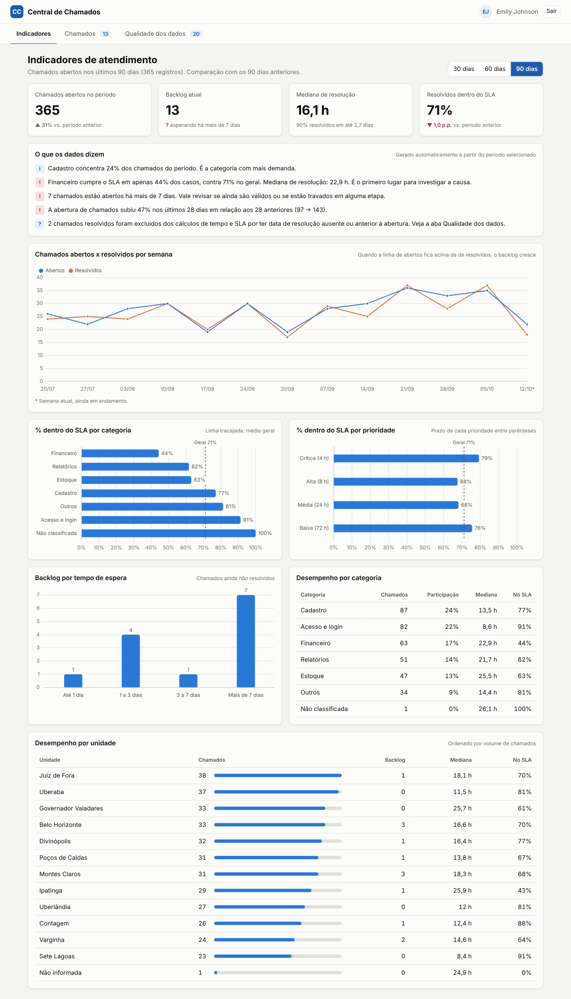
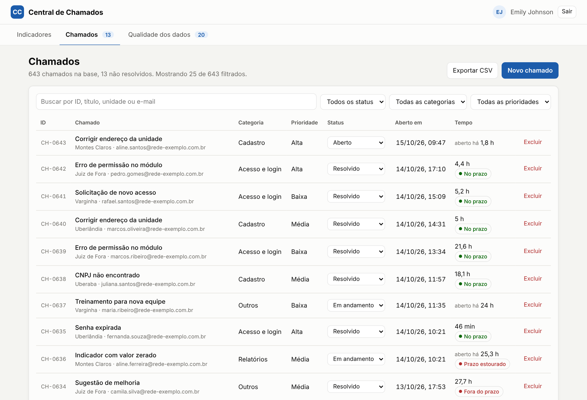
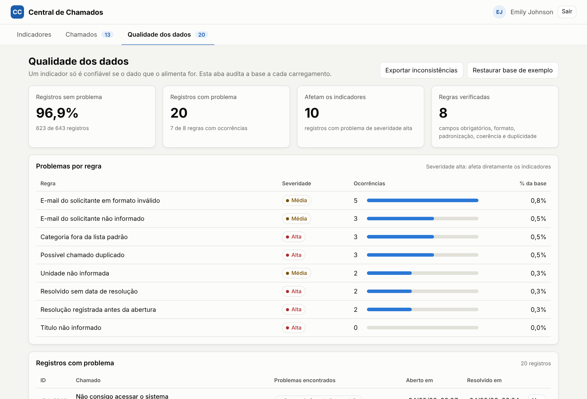

# Central de Chamados

Sistema de chamados de suporte com **painel de indicadores de atendimento** e **auditoria de qualidade dos dados**, feito em JavaScript puro (sem framework).

Inspirado na rotina de suporte a um sistema de gestão usado por várias unidades regionais. Além de abrir e acompanhar chamados, o objetivo é responder às perguntas que vêm depois: **estamos cumprindo o prazo? onde está o gargalo? dá para confiar nesses números?**

**Demo:** https://joaopedrobh04.github.io/central-de-chamados/ (conta de teste: `emilys` / `emilyspass`)



## O que o sistema faz

**Indicadores**
- KPIs do período (30, 60 ou 90 dias) comparados com o período anterior de mesmo tamanho: volume, backlog, mediana de resolução, percentil 90 e % resolvido dentro do SLA.
- **"O que os dados dizem":** frases geradas automaticamente que apontam onde agir (ex.: a categoria com pior cumprimento de SLA). Uma frase só aparece se a amostra for suficiente para não ser ruído.
- Gráficos de abertos x resolvidos por semana, SLA por categoria e por prioridade (com a média geral como referência) e backlog por tempo de espera.
- Tabelas de desempenho por categoria e por unidade.

**Chamados**
- Login com token (JWT) na API pública [DummyJSON](https://dummyjson.com/docs/auth), com rota protegida e tratamento de sessão expirada.
- Abertura de chamado com validação, mudança de status, exclusão, busca e filtros.
- Exportação para CSV (abre direto no Excel, com acentos corretos).

**Qualidade dos dados**
- 8 regras de auditoria rodando sobre a base a cada carregamento.
- % de registros sem problema, ocorrências por regra e lista dos registros afetados.
- Exportação das inconsistências em CSV para correção.

| Chamados | Qualidade dos dados |
| --- | --- |
|  |  |

## Definição dos indicadores

Indicador sem definição clara gera discussão sobre o número em vez de discussão sobre o problema. Estas são as regras usadas:

| Indicador | Como é calculado |
| --- | --- |
| Chamados no período | Chamados com data de abertura dentro da janela selecionada. |
| Backlog atual | Todos os chamados com status diferente de "Resolvido", independentemente do período (é um retrato de agora). |
| Tempo de resolução | Horas corridas entre abertura e resolução. |
| Mediana e P90 | A mediana mostra o caso típico; o P90 mostra o pior caso recorrente. A média fica de fora do destaque porque poucos chamados muito demorados a distorcem. |
| % dentro do SLA | Resolvidos dentro do prazo ÷ resolvidos com datas válidas. Prazos: Crítica 4 h, Alta 8 h, Média 24 h, Baixa 72 h. |
| Variação | Período atual x período anterior de mesmo tamanho. Para SLA, a diferença é em pontos percentuais (p.p.). |

**Dados inconsistentes não entram nas contas de tempo.** Um chamado "Resolvido" sem data de resolução, ou com resolução anterior à abertura, é excluído do cálculo de tempo e SLA, e o painel avisa quantos foram excluídos. Categorias digitadas fora do padrão não são corrigidas silenciosamente: aparecem como "Não classificada".

## Regras de qualidade

| Regra | Severidade | Por que importa |
| --- | --- | --- |
| Título não informado | Alta | Chamado sem descrição mínima não pode ser classificado. |
| Unidade não informada | Média | Some dos indicadores por unidade. |
| E-mail não informado | Média | Não há como dar retorno ao solicitante. |
| E-mail em formato inválido | Média | Comunicação não chega. |
| Categoria fora do padrão | Alta | Distorce o volume e o SLA por categoria. |
| Resolvido sem data de resolução | Alta | Impossível medir tempo e SLA. |
| Resolução antes da abertura | Alta | Gera tempo negativo e falseia a média. |
| Possível duplicado (mesmo título, solicitante e unidade em menos de 1 h) | Alta | Infla o volume e o backlog. |

Cada regra é uma classe com o mesmo método `verificar()`. Para criar uma regra nova, basta escrever a classe e incluí-la em `regrasPadrao()`.

## Arquitetura

```
central-de-chamados/
├── index.html                 login
├── app.html                   painel (abas Indicadores, Chamados e Qualidade)
├── css/style.css              tema claro e escuro
├── js/
│   ├── api/ApiClient.js       fetch centralizado: token, timeout e erros em português
│   ├── auth/AuthService.js    login, sessão e logout
│   ├── models/Chamado.js      regras de negócio do chamado (SLA, validação, status)
│   ├── data/
│   │   ├── ChamadoRepository.js   persistência no localStorage
│   │   └── SeedGenerator.js       base sintética reproduzível
│   ├── analytics/
│   │   ├── Metrics.js         indicadores (funções puras)
│   │   └── DataQuality.js     regras de auditoria (classes)
│   ├── utils/csv.js           leitura e escrita de CSV
│   ├── ui/                    renderização das telas e dos gráficos
│   └── pages/                 ponto de entrada de cada página
└── tests/                     testes automatizados (node:test)
```

A regra que guiou a organização: **cálculo separado de tela.** Métricas e regras de qualidade são funções e classes puras, sem acesso ao DOM. Isso permite testá-las no Node e reaproveitá-las se o projeto ganhar um back-end.

## Como rodar

O projeto usa ES Modules, então precisa ser aberto por um servidor (abrir o `index.html` direto do disco não funciona).

```bash
npm start          # sobe um servidor local em http://localhost:3000
```

Ou use a extensão **Live Server** do VS Code. Conta de teste: `emilys` / `emilyspass`.

## Testes

```bash
npm test
```

São 22 testes cobrindo indicadores, regras de qualidade, CSV, repositório, cliente HTTP e autenticação. A API é simulada nos testes, então eles rodam sem internet. O GitHub Actions executa a suíte a cada push e pull request.

## Sobre os dados

A base é **sintética**, gerada com semente fixa (sempre a mesma), com 640 chamados ao longo de 180 dias. Cerca de 3% dos registros recebem problemas propositais para alimentar a auditoria. O padrão "Financeiro é a categoria mais lenta" foi colocado no gerador de propósito, para validar que o painel consegue revelar um gargalo real. Nenhum dado de pessoa ou empresa real é usado.

## Próximos passos

- Back-end próprio em Node + Express com JWT, substituindo o DummyJSON (só a `baseUrl` do `ApiClient` muda).
- Importação de CSV com a auditoria rodando antes de gravar.
- Histórico de mudanças de status, para medir tempo em cada etapa.

## Tecnologias

JavaScript (ES Modules), HTML, CSS, Chart.js, Fetch API, localStorage, node:test, GitHub Actions.
